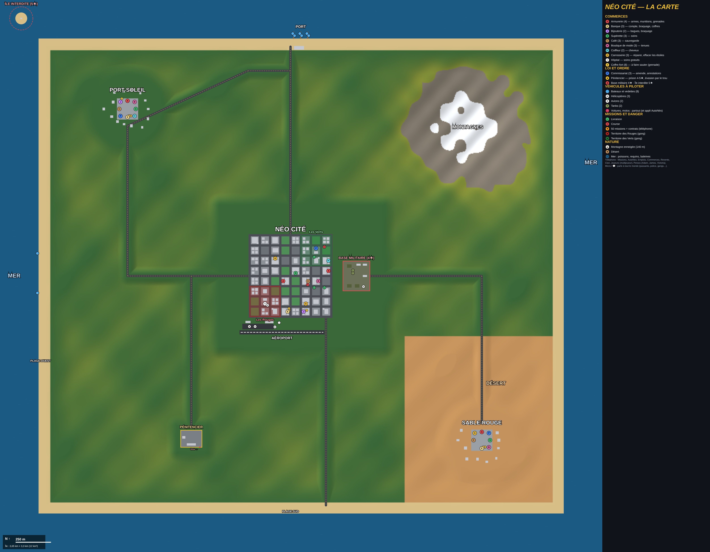

# Néo Cité

Jeu de ville ouverte en 3D dans le navigateur (Three.js, aucun build) : conduite, police et étoiles de recherche, armes, téléphone, base militaire, micro.

- `index.html` : le jeu
- `assets/` : modèle humain animé et animations
- `assets/models/` : modèles 3D issus du dossier Google Drive « 3D », convertis en GLB compressés (meshopt + textures WebP)
  - véhicules : Volvo V50 (berline, police), Kia Picanto (taxi, citadine), Honda NSX (sportive), Honda Sonic 150R (moto), Kawasaki Ninja H2R (superbike), hélicoptère de police
  - personnages : James, Adam (squelette Mixamo, animations partagées) — les seuls jouables
  - PNJ (`pnj_*.glb`) : pull, blond, femme en tailleur, agent, pilote, soldat — mélangés avec Adam et James, tenues de couleurs variées
  - armes : Deagle, AK-47, AUG, carabine, minigun, railgun
  - chaque `.glb` a un `.json` (dimensions, roues, volant) utilisé par le jeu ; les voitures ont aussi une version allégée `_lo` affichée au loin
- Modèles tiers (crédits) :
  - « Car Concept » © 2024 Darmstadt Graphics Group GmbH, modèle et textures Eric Chadwick — CC BY 4.0 (Khronos glTF Sample Assets)
  - Ferrari 458 Italia par vicent091036, distribué avec les exemples three.js

## Multijoueur

Cocher « Jouer en ligne » sur l'écran titre : tous les joueurs du salon public se retrouvent dans la même ville (ou dans un salon privé en saisissant le même code).
Connexion pair à pair WebRTC via [Trystero](https://github.com/dmotz/trystero) (signalisation par trackers WebTorrent et relais Nostr publics, aucun serveur à héberger).
Synchronisés : position, personnage, animations, arme et visée, véhicule (voiture ou moto), tirs, dégâts entre joueurs, K.O. La circulation et les passants restent propres à chaque joueur.

## Vie criminelle

- 3 personnages jouables (Adam le pilote, James le fou de la gâchette, Victoria la femme d'affaires), chacun avec son argent et sa position ; changement depuis la carte (bouton en haut à gauche) ou l'appli Persos.
- Arme à feu en main = visée directe. Pointer l'arme sur un vendeur = braquage de la caisse.
- Grenades (armurerie) ; coffres-forts dans la banque et la bijouterie à faire sauter.
- Objets à ramasser (rues, passants, braquages, coffres) avec un état en % ; appli Revente.
- Applis : AutoNéo (acheter des véhicules), Emplois (taxi, bus, livreur, vendeur), Commerces (revenus par heure), Clan, Joueurs (appels).
- Gangs : territoires des Rouges et des Verts, membres armés, guet-apens.
- Multijoueur : clans (pas de tir ami), chat vocal au micro selon la distance, appels.

## Missions et monde

- Histoire de 50 missions (braquages de bijouterie et de banque, grand braquage avec choix du plan), contrats illimités, petits boulots.
- Arme à feu en main : viseur affiché et visée automatique sur la cible la plus proche devant soi (cercle rouge).
- Carte : cliquer / toucher pour placer un point de passage (violet).
- Grande île de 3,65 km × 3,3 km (12 km²) : centre-ville de Néo Cité, villes de Port-Soleil et Sable-Rouge (armureries, banques, commerces), montagnes enneigées, désert, collines, forêts, routes ; mer à perte de vue, poissons qui suivent le joueur.
- Carte : zoom ×1 / ×3 / ×8, boutons « Armurerie / Banque / Supérette la plus proche ».
- Dégâts réalistes : impacts de balles, vitres qui éclatent, carrosserie qui se salit, fumée puis feu ; réparation à la carrosserie.
- Côtes : mer, plages, port, aéroport, base militaire (4 étoiles), île militaire interdite (5 étoiles), hélicoptère militaire qui attaque à 5 étoiles.
- Véhicules : bateaux, vedettes, avions, hélicoptères, tanks (en plus des voitures et motos). Hélico : Z/S avancer, Q/D tourner, Espace monter, Maj descendre. Avion : Z/S gaz, Q/D virer, Espace cabrer, Maj piquer.
- Mer : on nage (pas d'arme), les voitures coulent, poissons, requins (dangereux), baleines.
- Coiffeur, plus de passants.

## Parler aux gens

- Bouton MICRO (ou V) : le jeu écoute en continu ; parle à la personne en face de toi. Sans micro : bouton 💬 ou touche Entrée pour écrire.
- Chacun a un caractère (calme, sympa, peureux, agressif, parfois armé) et répond à voix haute avec une bulle : nom, métier, blagues, indique un lieu sur ta carte, te suit, se bat, sort une arme, fuit, donne son argent si tu le braques, appelle la police.
- Policiers à pied (arrestation, « je me rends », pot-de-vin), militaires (base, île interdite), membres de gang (vente d'armes, initiation pour rejoindre le gang), vendeurs (« je voudrais acheter », braquage à la voix avec une arme).
- Les gens t'adressent aussi la parole quand tu passes à côté.

## Police, arrestations et prison

- La police met du temps à arriver : 30 s à 1 étoile, 22 s à 2, 15 s à 3, 10 s à 4, 6 s à 5 (compte à rebours sous l'horloge).
- Un commissariat dans chaque ville. Arrestation : 1 étoile = amende de 150 $ ; 2-3 étoiles = on t'enlève tout (armes, objets, 30 % de l'argent) ; 4-5 étoiles = pénitencier (3 ou 5 minutes).
- Au pénitencier : dormir dans sa cellule réduit la peine, pas de téléphone ; un trou dans le mur du fond permet de s'évader (4 étoiles, les gardiens tirent).
- Visée sans point ni cercle rouge (viseur simple, aide à la visée invisible).

## Tirer sur les voitures

- **Pneus** : vise une roue pour la crever (bruit d'éclatement, poussière). La roue s'écrase, la voiture penche de ce côté, tire d'un côté, ralentit, et la jante frotte en faisant des étincelles. Pratique pour stopper la police ou une voiture qui fuit.
- **Carrosserie** : chaque balle laisse un trou bien visible, avec étincelles et bruit de métal ; les vitres touchées se brisent.
- La carrosserie (garage) répare tout : trous, vitres et pneus.

## Sang et blessures

- Chaque balle projette du sang dans la direction du tir, avec des éclaboussures au sol derrière la victime.
- **Zone touchée** : **jambe** → la personne boite, crie et laisse une traînée de gouttes (2e balle dans la jambe = elle tombe) ; **torse** → elle tombe et saigne, plusieurs balles la tuent ; **tête** → mort immédiate.
- Une **flaque de sang** se répand sous les corps.
- **Taches de sang sur les personnages**, à l'endroit exact de l'impact (tête, torse, jambe), avec coulure ; elles restent sur la personne.
- Les gouttes **retombent au sol** (gravité), le sang **gicle sur les murs** derrière la victime, et une personne blessée continue de saigner par petits jets.
- Se faire renverser par une voiture ou frapper au couteau / katana fait aussi saigner.
- **Écran** : les bords rougissent quand tu es touché, et restent rouges quand ta santé est basse.
- En visant, la visée assistée garde la hauteur de ton viseur : vise bas pour les jambes, haut pour la tête.
- **Toi aussi** : touché à la jambe tu boites (pas de sprint pendant 12 s), et tu laisses des gouttes quand tu es gravement blessé.

## Commissariats et garde à vue

- Les 3 commissariats ont un vrai intérieur : accueil avec policier, bureaux avec ordinateurs, casiers, avis de recherche et **2 cellules à barreaux**.
- Arrêté avec **2 étoiles** : 45 s de garde à vue ; **3 étoiles** : 75 s (armes, objets et 30 % du liquide confisqués).
- **S'évader** : appuie plusieurs fois sur **E** près de la porte pour crocheter la serrure. Si le policier t'entend, le crochetage repart à zéro (+15 s). Une fois dehors : 3 étoiles, toute la police te cherche.

## Armurerie, FBI et chiens policiers

- **Armurerie** : 4 boutiques d'armes (2 à Néo Cité, Port-Soleil, Sable-Rouge). Enseigne rouge « ARMES » qui tourne sur le toit, panneau au bord du trottoir, faisceau rouge visible de loin et **A rouge** toujours affiché sur la mini-carte. Appli **Armurerie** sur le téléphone : GPS vers la plus proche ou achat en ligne (livraison +15 %).
- **FBI** (3 étoiles et plus) : berlines noires banalisées avec gyrophares, les agents en costume descendent et tirent ; ils peuvent te menotter de près.
- **Agents secrets** : certains passants sont des policiers infiltrés qui se révèlent quand tu es recherché (2 étoiles et plus).
- **Chiens policiers** : des maîtres-chiens patrouillent, et à partir de 2 étoiles les voitures de police lâchent un chien ; il court plus vite que toi et mord. On peut le repousser (coup de pied) ou lui tirer dessus (+1 étoile).

## La carte complète

Version haute définition : [carte-neo-cite.png](carte-neo-cite.png) (5010×3900).

## Previews

Chaque branche poussée est publiée par GitHub Actions sur la branche `gh-pages` :

- `main` → https://adrien426.github.io/GTA5/
- toute autre branche → https://adrien426.github.io/GTA5/preview/<branche>/

Supprimer une branche supprime sa preview. Dans *Settings → Pages*, choisir « Deploy from a branch », branche `gh-pages`, dossier `/ (root)`.
